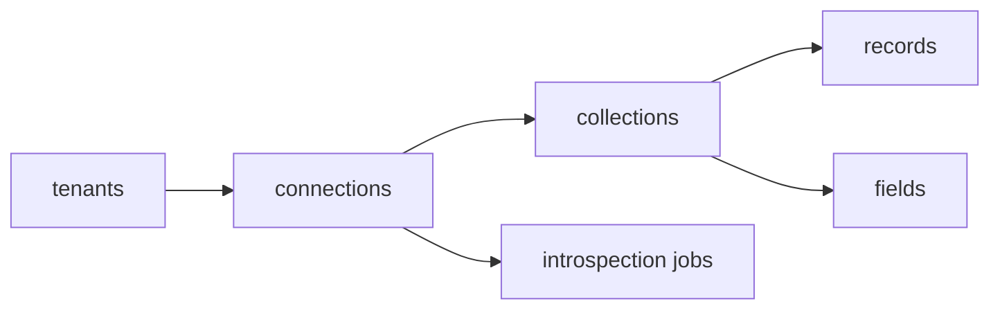

# 8. API

One contract for every client. REST is the primary surface; GraphQL is generated from the same content model; OpenAPI is the source for SDK generation.

## Resources



## REST endpoints (v1)

| Method | Path | Purpose |
|---|---|---|
| POST | `/v1/connections` | Create a connection (validated, read-only by default) |
| GET | `/v1/connections` | List connections |
| GET | `/v1/connections/{id}` | Connection detail and health |
| PATCH | `/v1/connections/{id}` | Update config, mode, secret reference |
| DELETE | `/v1/connections/{id}` | Remove connection and stored secret |
| POST | `/v1/connections/{id}/introspect` | Start an introspection job |
| GET | `/v1/connections/{id}/collections` | List collections and fields |
| PATCH | `/v1/collections/{id}` | Edit display name, field UI hints, exposure |
| GET | `/v1/connections/{id}/collections/{name}/records` | List records (filter, sort, cursor) |
| GET | `/v1/connections/{id}/collections/{name}/records/{rid}` | Get one record |
| POST | `/v1/connections/{id}/collections/{name}/records` | Create |
| PATCH | `/v1/connections/{id}/collections/{name}/records/{rid}` | Update |
| DELETE | `/v1/connections/{id}/collections/{name}/records/{rid}` | Delete |
| POST | `/v1/connections/{id}/batch` | Batch writes |
| GET | `/v1/audit` | Query the audit log |
| POST | `/v1/workspaces/signin` | Trade a Firebase ID token for a session in the person's own workspace (doc 30) |
| GET | `/v1/schema` | The loaded schema file and where it differs from each connection; admin only (doc 29) |
| POST | `/v1/connections/{id}/files` | Upload an image or PDF (doc 31) |
| GET, HEAD | `/v1/files/{id}/{fileId}` | Download a file; private files need a token |
| DELETE | `/v1/connections/{id}/files/{fileId}` | Remove a file; admin only |
| GET | `/v1/connections/{id}/counts` | How many records each collection holds, in one call (see "Counting records") |
| GET | `/v1/connections/{id}/collections/{name}/count` | How many records match a filter |
| PUT, DELETE | `/v1/connections/{id}/collections/{name}/drafts/{draftId}/schedule` | Publish a draft by itself later, or cancel that (doc 13) |
| GET, POST | `/v1/admin/origins` | List the browser sites allowed to call the gateway, and allow one; admin only (doc 12) |
| DELETE | `/v1/admin/origins/{id}` | Stop allowing a browser site; admin only |
| GET | `/v1/health` | Liveness and readiness |

Workspace requests use the prefix `/w/{workspaceId}`, for example `/w/{workspaceId}/v1/connections`.

Write endpoints return `READ_ONLY` on read-only connections.

## Listing records

```
GET /v1/connections/c1/collections/orders/records
    ?filter={"and":[{"field":"status","op":"eq","value":"paid"}]}
    &sort=-created_at
    &fields=id,status,total
    &limit=50
    &cursor=eyJ...
```

Response:

```json
{
  "data": [ { "id": "o_1", "status": "paid", "total": 120 } ],
  "page": { "nextCursor": "eyJ...", "limit": 50 },
  "meta": { "capabilityNotes": [] }
}
```

`capabilityNotes` lists emulated or degraded behaviour (for example "sort emulated at gateway").

## Counting records

```
GET /v1/connections/c1/collections/orders/count?filter={"and":[{"field":"status","op":"eq","value":"paid"}]}&max=1000
```

```json
{ "data": { "count": 1000, "exact": false } }
```

The gateway counts by paging through the keys with the caller's own permissions, so a count never includes a record that a list would hide, and no adapter has to change. Counting stops at `max` (default 1000, at most 10000). `exact: false` means "at least this many". The same answer is kept for 30 seconds and forgotten when a record is created or deleted through the gateway. `GET /v1/connections/{id}/counts` returns `{ "data": { "<collection>": { "count", "exact" } } }` for every collection the caller can read; a collection whose count fails shows `null` and does not stop the others.

## Pagination

Cursor-only. Cursors are opaque, signed and bound to the query, so a client cannot alter the filter between pages. Offset pagination is offered only where the adapter's `pagination.offset` flag is true.

## Errors

```json
{
  "error": {
    "code": "CAPABILITY_UNSUPPORTED",
    "message": "Sorting by 'total' is not supported on this connection",
    "details": { "adapter": "dynamodb", "field": "total" },
    "requestId": "req_8f2a"
  }
}
```

| Code | HTTP |
|---|---|
| `VALIDATION_FAILED` | 400 |
| `AUTH_FAILED` | 401 |
| `FORBIDDEN` | 403 |
| `NOT_FOUND` | 404 |
| `CONFLICT` | 409 |
| `CAPABILITY_UNSUPPORTED` | 422 |
| `READ_ONLY` | 403 |
| `RATE_LIMITED` | 429 |
| `CONNECTION_FAILED` | 502 |
| `TIMEOUT` | 504 |
| `INTERNAL` | 500 |

## GraphQL

Generated per tenant from the content model: one type per collection, connections for paginated lists, and the same permission checks as REST. Cross-source relations resolve at the gateway with batching.

## Authentication

Bearer token from the OIDC provider. Service tokens for server-to-server use are scoped to a tenant and a role, are rotatable, and are never accepted from browsers.

## Rate limits and idempotency

- Per-tenant and per-connection rate limits.
- Writes accept an `Idempotency-Key` header.

## Versioning

Path-versioned (`/v1`). Breaking changes ship as `/v2`; additive changes do not bump the version.
