# 11. Roadmap

Estimates assume one or two engineers and are rough planning guesses, not benchmarks.

## Where we are (October 2026)

| Phase | State |
|---|---|
| 1. Foundation | Done: core (29 tests), adapter contract and test kit |
| 2. Security spine | Done: vault, token auth, audit log, network guard, rate limits, idempotency, single sign-on (OIDC, tested only against a fake identity provider) |
| 3. First path | Done: PostgreSQL adapter and gateway, tested against a live database |
| 4. More adapters | Done: memory, PostgreSQL, SQLite, MySQL/MariaDB and MongoDB (all tested on real servers in CI), Firestore (tested on the emulator; experimental). Not started: SQL Server, DynamoDB, Redis |
| 5. Admin UI | Done for the first release: connections, content editing with drafts, publish, live preview, access, audit, settings |
| 6. SDKs | TypeScript SDK published to npm as 0.1.0 and used by four example apps and a live website. Python and Dart written but never run. Python and Go adapter templates not yet aligned with the gRPC protocol |
| 7. Hardening | Not started: load tests, penetration review, key-rotation drill, cloud-identity connections |

Also done outside the original plan: CI/CD workflows for every repository, a one-image release build, and agent guides (`AGENTS.md`).

Also done: all ten 0.1.0 packages are on npm, the repositories are public, and a hosted gateway with the admin app runs on Vercel with Firestore state (doc 26; seven live state-store tests pass against the Firestore emulator).

Also done (October 2026): sign-in with Google and GitHub through Firebase, per-person workspaces (doc 30), schema as code (doc 29), images and PDFs stored in Firestore with cleaning and limits (doc 31), a content page with a collections sidebar, search in the top bar, a field picker and edit as code (doc 32), and every source file split to 700 lines or fewer (doc 33). The workspaces, schema and file features are tested only against fakes.

Also done (November 2026): record counts in the sidebar (doc 8), singleton collections (doc 29), scheduled publishing (doc 13), a CORS origins screen with one-click allow (doc 12), a brand file (`theme.css`) and contrast fixes (doc 32), and `@sethucms/sdk` 0.2.0 with counts and drafts. Tested against the memory adapter and, for the multi-gateway publish claim, one PostgreSQL 16 server. Not yet checked: MySQL, MongoDB and Firestore with these features, a screen reader, and real phones.

Also done (November 2026): per-workspace browser origins, with `SETHUCMS_ADMIN_ORIGINS` so one person's sites cannot call another person's workspace (docs 12 and 30); a sign-in bridge so people can sign in from their own sites without Firebase console edits (doc 30); and a workflow that deploys the gateway to Vercel on every push (doc 26).

Next, in this order: run workspaces, file storage and Firebase sign-in on a real Vercel, Firestore and Firebase setup; per-workspace quotas; run the container image, Compose file and deploy workflows end to end; run MongoDB and Firestore tests against real servers; native change capture from the databases; custom roles and webhook screens in the admin app; business and vendor dashboards; a `create-sethucms` starter and helper libraries for React and Angular.

```mermaid
gantt
    title SethuCMS MVP (weeks)
    dateFormat  X
    axisFormat  W%s
    section Foundation
    Root config, core, protocol, control-plane DB :0, 2
    section Security spine
    vault, auth, audit, network-guard :2, 4
    section First path
    postgres adapter + conformance + API :4, 6
    section Adapters
    mongodb, firestore, mysql, mssql, dynamodb :6, 10
    section Clients
    Admin UI :8, 12
    SDKs (TS, Dart, Python) :10, 12
    section Hardening
    Security tests, load tests, docs, cloud identity :12, 14
```

## Phases

| Phase | Goal | Exit criteria |
|---|---|---|
| 1. Foundation | Repo, core types, adapter protocol, control-plane schema | `core` builds; migrations apply cleanly |
| 2. Security spine | Vault, auth, audit, network guard | Secrets encrypted end to end; SSRF tests pass |
| 3. First path | Postgres adapter plus API, request to database | Conformance suite green on Postgres |
| 4. More adapters | MongoDB, Firestore, MySQL, SQL Server, DynamoDB | Each passes conformance and security suites |
| 5. Admin UI | Connect, introspect, edit, permissions | Editor can complete a full content edit via UI only |
| 6. SDKs | Generated Dart and Python, hand-tuned TS | Sample apps (Next.js, Flutter, FastAPI) run |
| 7. Hardening | Load, security review, docs, cloud identity | Penetration review done; key-rotation drill done |

## File counts (hand-written, MVP)

| Area | Files |
|---|---|
| Root config | ~12 |
| core | ~15 |
| protocol + adapter-sdk | ~13 |
| 6 adapters | ~36 |
| vault | ~8 |
| auth | ~10 |
| audit + network-guard | ~11 |
| api | ~25 |
| worker | ~12 |
| admin | ~40 |
| control-plane DB | ~10 |
| sdk-ts | ~8 |
| Dart SDK (hand-written) | ~8 |
| Python SDK (hand-written) | ~9 |
| Go + Python adapter templates | ~16 |
| infra | ~15 |
| tests | ~20 |
| CI + docs | ~20 |
| **Total** | **~290** |

The earlier rough estimate was 200-250; this table sums slightly higher once every area is counted. Treat both as ballpark.

## After the MVP

- Cosmos DB, Spanner, BigQuery, Redshift, Redis, Firebase RTDB
- Realtime subscriptions across adapters
- gRPC endpoint
- Third-party adapters in Go, Python and other languages
- Pricing and billing (per connection is the main cost driver)
- Agentic schema writer, dashboards, and Free, Pro and Ultra hosted plans (doc 27)

## Risks

| Risk | Mitigation |
|---|---|
| Capability gaps make some databases feel second class | Honest capability flags; clear UI messaging |
| Credential handling mistakes | Security spine built before any adapter; key-rotation drill |
| Scope creep across databases | Ship six adapters; add others only on demand |
| Prisma or driver version changes (for example MongoDB support) | Avoid a single ORM for all stores; isolate drivers inside adapters |
| Licensing of embedded tools | Prefer MIT/Apache components; legal review before embedding source-available tools |

## Databases we plan next

A November 2026 review of the databases people use, compared with what SethuCMS supports, gave this order. The effort figures are estimates, and no customer-demand data went into the ordering after SQL Server.

1. Fix the adapter docs and label each database GA, Beta or Experimental (done for the pages that contradicted our CI: docs 5, 18, 28).
2. Run the conformance suite against Postgres-protocol and MySQL-protocol services (Supabase, Neon, Aurora, CockroachDB, TiDB), with a profile for connection poolers.
3. Turso/libSQL, reusing the SQLite dialect.
4. Open up `sql-kit` (dialect list, paging) and add SQL Server, the largest missing engine.
5. MongoDB flavours: DocumentDB, Cosmos DB for MongoDB, FerretDB.
6. Read-only analytics adapters, ClickHouse first, then BigQuery, Snowflake and DuckDB.
7. Per-workspace namespacing for PostgreSQL gateway state, so workspaces can run on PostgreSQL (doc 30 says they cannot yet).
8. DynamoDB, then Redis/Valkey.
9. Search engines (Meilisearch, Typesense) as sync targets, not content stores; Oracle only on demand.

Graph, time-series and dedicated vector databases are not planned as content sources. Prisma and Drizzle are not databases: they would be a way to import a schema on top of live introspection, not an adapter. The items are tracked on the SethuCMS project board.
