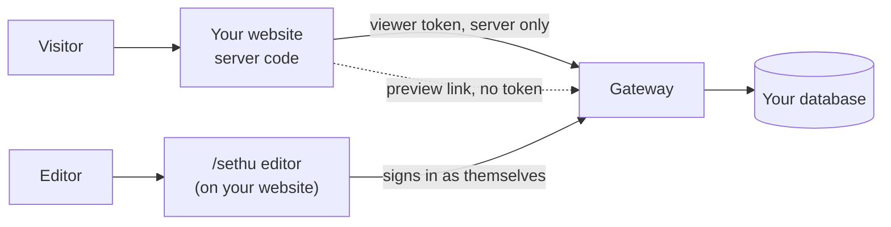

# 34. Put SethuCMS on your website, start to finish

This page ties the others together: how a website reads its content from SethuCMS, how editors change that content, and how counts, singletons, previews, scheduling and CORS fit in. Each step names the page that has the detail.

## The picture



- The website's **server** reads content with a viewer token. Visitors never see the token.
- Editors use the content-only editor at `/sethu` on your own site. It calls the gateway from the browser, so your site's address must be on the CORS list (step 4).
- Nothing reaches your database from an edit until someone presses **Publish**, or a scheduled time arrives.

## Step 1. Run a gateway

Run your own (doc 28) or use the hosted one (doc 26). You need its https address, for example `https://cms.example.com`. Scheduled publishing needs a gateway that keeps running, so it does not work in serverless mode (doc 13).

## Step 2. Connect your database and describe your content

1. In the admin app, **Connections, New connection**. Start **read-only** and expose **only the collections the site reads** (doc 26 explains why).
2. Optionally add a schema file so editors get sensible labels and rules (doc 29):

```js
// sethucms.schema.mjs, loaded with SETHUCMS_SCHEMA_FILE=./sethucms.schema.mjs
export default {
  collections: [
    { name: 'settings', title: 'Site settings', singleton: true },      // exactly one record
    { name: 'articles', titleField: 'title', fields: [{ name: 'title', required: true, maxLength: 140 }] },
  ],
};
```

A **singleton** (site settings, a home page) has no list in the editor, and the gateway refuses a second record or a delete.

## Step 3. Read the content from your website

```sh
npm install @sethucms/sdk     # 0.2.0 or newer for counts and drafts
```

Create a **Viewer** token for this site (Roles and access, API tokens) and keep it in the server's environment, never in browser code:

| Variable | Value |
|---|---|
| `SETHUCMS_BASE_URL` | The gateway address (https) |
| `SETHUCMS_TOKEN` | A viewer token made for this site |
| `SETHUCMS_CONNECTION_ID` | The connection id (starts with `conn_`) |

```ts
import { SethuClient, eq } from '@sethucms/sdk';

const cms = new SethuClient({
  baseUrl: process.env.SETHUCMS_BASE_URL!,
  token: () => process.env.SETHUCMS_TOKEN!,
});
const conn = process.env.SETHUCMS_CONNECTION_ID!;

// A list
export const latestArticles = () =>
  cms.collection(conn, 'articles').where(eq('status', 'published')).orderBy('created_at', 'desc').limit(10).list();

// A singleton: the one settings record, or null if it was never created
export const siteSettings = () => cms.collection(conn, 'settings').query().first();

// How many there are (exact: false means "at least")
export const articleCount = () => cms.collection(conn, 'articles').count();
```

In Next.js, call these from Server Components or route handlers and cache the page (for example `revalidate: 60`), so the gateway is asked about once a minute and not once per visitor. Other stacks work the same way (doc 25).

Counts and lists use the token's own permissions: a count never includes a record the token could not list.

## Step 4. Let editors work on your site

Build the content-only editor into your website's `public/sethu` folder (doc 32):

```sh
VITE_API_URL=ask VITE_CONTENT_ONLY=true VITE_DEFAULT_GATEWAY=https://cms.example.com \
  pnpm vite build --base=/sethu/ --outDir ~/my-site/public/sethu
```

Then:

1. **Allow your website in CORS.** In the admin app, **CORS origins**, add your site's exact address (for example `https://www.example.com`). If you forget, the editor's calls fail with "blocked by CORS policy". Open `/sethu` once, then use **Allow this site** under *Recently refused* (doc 12). Server-side calls from your website's code do not need this.
2. **Give each editor an account** with the Editor role (doc 28, step 2), or a token with the Editor role.
3. **Content-Security-Policy.** If your site sets one, `/sethu` needs a looser one for Google sign-in (doc 32).

Editors then see the collections with record counts, edit with autosaved drafts, and see **Unpublished changes** until they publish.

## Step 5. Preview, schedule, publish

- **Live preview.** In the editor, **Live preview** gives a signed link valid for 15 minutes that shows the draft merged over the published record, and updates as the editor types (doc 13). Your own preview page can read it with no token:

```ts
const res = await fetch(`${gateway}${previewPath}`);              // the record with the draft applied
const events = new EventSource(`${gateway}${previewPath}/events`); // updates as the editor types
```

  This is a browser call to the gateway, so the preview page's address must be on the CORS list too.
- **Schedule.** Under the form, **Schedule** picks a date and time. The gateway publishes the latest saved values then, even if the editor has closed the page. A failure is kept as a reason and the schedule is cleared (doc 13).
- **From code**, with the SDK:

```ts
const articles = cms.collection(conn, 'articles');       // needs an Editor token, server side only
const draft = await articles.drafts.create({ recordId: 7, values: { title: 'New title' } });
await articles.drafts.schedule(draft.id, new Date('2026-12-01T09:00:00+05:30'));
await articles.drafts.cancelSchedule(draft.id);
```

- **See the change on your site.** The website reads published data only. After a publish, a cached page shows it when its cache expires (step 3).

## Step 6. Check it works

| You see | Cause | Fix |
|---|---|---|
| The editor says "blocked by CORS policy" or `Failed to fetch` | Your website's address is not allowed | Add it under **CORS origins** (step 4) |
| `401` | Token missing, wrong or expired | Create a new token; keep it on the server |
| `403` | The token's role cannot do that, or the collection is not exposed | Check the role and the exposed collections |
| Schedule says `CAPABILITY_UNSUPPORTED` | The gateway runs in serverless mode | Use a gateway that stays running |
| `409` with `reason: "singleton"` | A second record, or a delete, on a singleton collection | Edit the existing record instead |
| The site still shows old content after publishing | The page is cached | Wait for the cache to expire, or lower `revalidate` |
| Vercel returns a login page instead of JSON | Deployment Protection is on for the gateway project | Turn it off (doc 26) |

## What has and has not been tested

Tested: the SDK against a real local gateway, the editor in a desktop browser, scheduled publishing with the gateway's own timer, and the multi-gateway publish claim on one PostgreSQL 16 server. Not tested: these steps on a live customer site end to end, MySQL, MongoDB and Firestore with counts and scheduling, a screen reader, and real phones.
